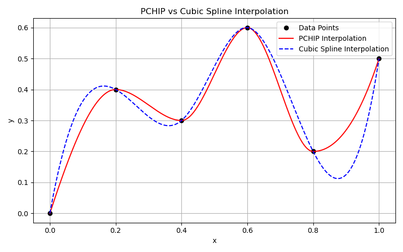

# ParametricNozzleGenerator
>## Introduction
>A parametric nozzle geometry/meshing tool built using the OpenCascade C++ API and GMSH (.geo) scripting. 

>## What it does/How it works?
>The program takes a set of inputs (listed in inputs.yaml). In order to effectively use this tool it is imperative to understand the coefficients for the spline interpolation are >dimensionless, as they move from 0.0 to 1.0 in a linear fashion, the inputs are listed as the following:
>1. First item
>2. Second item
>3. Third item
>4. Fourth item

Then with the inputs, the program converts the dimensionless coefficients into a Piecewise Cubic Hermite Interpolating Polynomial (PHIP) based spline interpolation algorithm. This specific algorithm was utilized in order to preserve monotonicity and minimize the change for sharp overshoots that would cause issues in mesh generation. 

  

